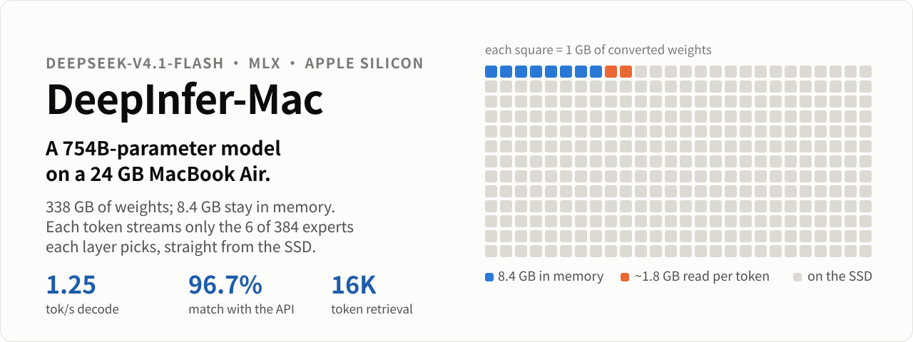
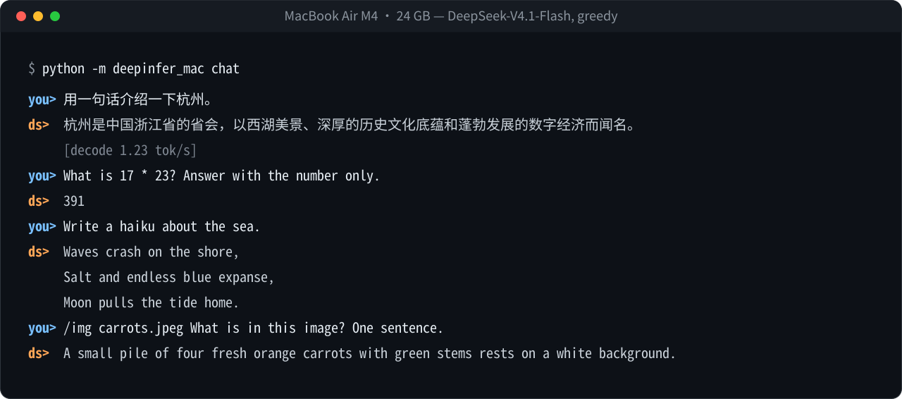
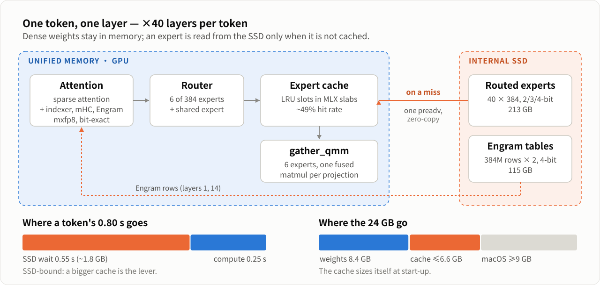

# DeepInfer-Mac

<p align="left">
  <a href="LICENSE"></a>
  
  
  <a href="https://github.com/ml-explore/mlx"></a>
  <a href="https://huggingface.co/deepseek-ai/DeepSeek-V4.1-Flash-1017"></a>
  <a href="../../actions/workflows/ci.yml"></a>
</p>

[English](README.md) | [简体中文](README_zh.md)

<p align="center"></p>

DeepInfer-Mac 在一台 Apple Silicon Mac 上运行 **DeepSeek-V4.1-Flash**（7540 亿参数）——在
**24 GB 统一内存的 MacBook Air M4** 上开发与测试。它基于 [MLX](https://github.com/ml-explore/mlx)
复现了 DeepSeek [DeepInfer](https://github.com/deepseek-ai/DeepInfer) 的模型侧能力，并用 **SSD 专家流式加载**
替代 DeepInfer 的多卡专家并行：常驻的稠密权重占 8 GB，每层每个 token 选中的 6 个路由专家按需从 SSD 读取。

> 本项目为独立的社区项目，与 DeepSeek 官方无关，也未获其背书。

支持的模型：

- DeepSeek-V4.1-Flash（`deepseek-ai/DeepSeek-V4.1-Flash-1017`）

支持的特性：

- 官方参考实现的 MLX 移植，并与之逐层对齐测试
- SSD 专家流式加载（零拷贝读入 MLX slab，按槽位 `gather_qmm`）
- DSpark 与基于置信度的验证调度
- SWA Bounded Replay
- 多轮对话前缀复用
- 结构化输出
- 图像输入（ViT + aligner，VL 路由偏置）
- 基于 [deepseek-recipe](https://github.com/deepseek-ai/deepseek-recipe) 的 OpenAI / Anthropic / Responses 兼容服务

<details>
<summary>特性细节与配置</summary>

- **模型：** 滑动窗口 + 压缩稀疏注意力（两级 indexer、跨层 KV 共享）、Engram n-gram 记忆、Hyper-Connections（Sinkhorn）、
  384 专家 MoE（sqrt-softplus 路由），以及训练时的 fp8/fp4 激活与缓存舍入——均按 `inference/model.py` 一一移植。
  prefill 与 decode 共用一条代码路径，可在任意位置处理任意长度的 chunk。
- **SSD 专家流式加载：** 专家以页对齐记录存储；未命中时在预分配的 slab 中取一个槽位，一次 `preadv`（`F_NOCACHE`）
  直接写入统一内存。每层所有路由专家以每个投影一次 `gather_qmm` 完成。`--cache-gb` 设置 slab 大小
  （默认：内存 − 稠密权重 − 9.5 GB）。
- **DSpark 与置信度验证调度：** 草稿层、Markov 头与置信度头，通过投机拒绝采样验证（任意温度下均精确）。
  用 `--spec` 或 `DEEPINFER_ENABLE_MTP_VARLEN=1` 开启；`DEEPINFER_USE_NEXTN_DECODE` 设置最大草稿长度（默认 5）。
  在受限于 SSD 带宽的机器上，只有专家缓存较热时才有收益。
- **SWA Bounded Replay：** 最后一个 KV 源层及之前的层处理完整 prompt；之后的 decoder 层只重放有界后缀。
  默认 `DEEPINFER_YOCO_PREFILL_TRUNCATION_MODE=compact`、`DEEPINFER_YOCO_PREFILL_KEEP_TOKENS=140`，与 DeepInfer 一致。
- **前缀复用：** 若新请求的 prompt 是上一次的延续，只计算新增 token（DeepInfer 开源版不含 KV cache 系统）。
- **结构化输出：** 向 `SamplingParams` 传入 `so_args={"schema_type": "json" | "regex" | "ebnf" | "json_object", "schema": ...}`
  （基于 [xgrammar](https://github.com/mlc-ai/xgrammar)）；见 [examples/structured_output.py](examples/structured_output.py)。
- **确定性采样：** 向 `SamplingParams` 传入固定的 `seq_seed`。

</details>

支持的硬件：

- Apple Silicon Mac（M1 及以上），统一内存 ≥ 24 GB，SSD 空闲约 360 GB（用于转换）

相比 DeepInfer 未包含：

- 多设备并行（Attention DP/CP、MoE EP + EPLB）、多请求 batch 不变性

## 实际效果

MacBook Air M4（24 GB）上 `python -m deepinfer_mac chat` 的真实输出（贪心解码）：

<p align="center"></p>

<details>
<summary>文本版</summary>

```text
you> 用一句话介绍一下杭州。
ds>  杭州是中国浙江省的省会，以西湖美景、深厚的历史文化底蕴和蓬勃发展的数字经济而闻名。
     [decode 1.23 tok/s]
you> What is 17 * 23? Answer with the number only.
ds>  391
you> Write a haiku about the sea.
ds>  Waves crash on the shore,
     Salt and endless blue expanse,
     Moon pulls the tide home.
you> /img carrots.jpeg What is in this image? One sentence.
ds>  A small pile of four fresh orange carrots with green stems rests on a white background.
```

</details>

## 快速开始

### 环境要求

- Apple Silicon 上的 macOS 14+
- Python 3.11+（推荐 [uv](https://github.com/astral-sh/uv)）

### 安装

```bash
git clone https://github.com/haoruilee/DeepInfer-Mac && cd DeepInfer-Mac
uv venv --python 3.12 && source .venv/bin/activate
uv pip install -e .
```

### 转换权重

转换器直接从 Hugging Face Hub 按区间读取每个张量，在 GPU 上转换后写入最终位置——510 GB 的原始权重从不落盘。
可随时中断续传；卡住的传输从断点续传，并在 `huggingface.co` 与 `hf-mirror.com` 之间轮换。

```bash
python -m deepinfer_mac convert --out ~/models/dsv41-mac   # 写入约 340 GB
python -m deepinfer_mac doctor                             # 进度、磁盘、内存、缓存大小
```

### 离线推理

```bash
python examples/offline_inference.py
```

```python
from deepinfer_mac import LLM, SamplingParams

llm = LLM()  # ~/models/dsv41-mac，或 $DEEPINFER_HF_MODEL_DIR
prompt_ids, _ = llm.chat_prompt([{"role": "user", "content": "你好！"}])
outputs = llm.generate(prompt_token_ids=[prompt_ids], sampling_params=SamplingParams(temperature=0.6, max_tokens=256))
print(llm.tokenizer.decode([o.token_id for o in outputs[0]]))
```

每个输出是逐 token 的 `RequestOutput(token_id, token_logprobs, prompt_len, draft_tok, accept_tok)` 列表，与 DeepInfer 相同。

### 对话与服务

```bash
python -m deepinfer_mac chat [--think]      # 终端多轮对话；图片用 /img photo.jpg <问题>
python -m deepinfer_mac serve --port 8000   # /v1/chat/completions、/v1/responses、/v1/messages
```

服务端用 deepseek-recipe 渲染 prompt、解析输出（思考、工具调用、JSON），客户端看到的 API 与 DeepSeek 官方一致。
见 [examples/openai_client.py](examples/openai_client.py)。

## 工作原理

稠密权重常驻内存；路由专家只在路由器选中、且不在缓存里时才从 SSD 读取——一次 `preadv`（`F_NOCACHE`）直接写进预分配的 MLX slab，零拷贝。解码速度由 SSD 带宽决定，专家缓存越大越快。详见 [docs/architecture.md](docs/architecture.md)。

<p align="center"></p>

## 权重格式

| 部分 | 官方发布 | DeepInfer-Mac | 大小 | 位置 |
| :--- | :--- | :--- | ---: | :--- |
| 稠密权重：注意力、共享专家、门控、mHC、Engram 投影 | FP8 e4m3，32×32 E8M0 | MLX **mxfp8**，比特级无损 | 7.7 GB | 内存 |
| 输出头 | BF16 | affine 8-bit | 0.7 GB | 内存 |
| 词嵌入 | BF16 | BF16（内存映射） | 1.3 GB | SSD |
| 路由专家，40 × 384 | FP4 e2m1 + E8M0/32 | affine g64 + 裁剪搜索：第 0–3、8、14 层及 decoder 区段 20–38 层 3-bit；第 39 层 4-bit；第 4–7、9–13、15–19 层 gate/up 2-bit、down 3-bit | 213 GB | SSD |
| DSpark 草稿专家，3 × 128 | FP4 | gate/up 2-bit，down 3-bit | 4.8 GB | SSD |
| Engram 表，2 × 3.84 亿行 | FP8 + E8M0/32 | 4-bit g32 + 裁剪搜索，每行 160 字节 | 115 GB | SSD |

磁盘充足时，在 `deepinfer_mac/format.py` 中改一行即可使用无损专家（MXFP4，约 296 GB）。

## 性能

MacBook Air M4，24 GB，内置 SSD，macOS 26，关闭其他应用：

| | |
| :--- | :--- |
| Decode | **最高 1.37 tok/s**（空闲窗口推测读取，专家缓存 6.5 GB；5.5 GB 时 1.24）。关闭时 1.07–1.25 tok/s，每 token 约 0.55 s 等待 SSD |
| 首 token 延迟：14 token / 1K / 16K 的 prompt | 10 s / 约 49 s / 约 8 分钟 |
| 多轮对话的后续轮次 | 只 prefill 新增 token |
| SSD 专家流式读取 | 2.8–3.15 GB/s；缓存命中率 49% 时每 token 读取约 1.8 GB 专家 |
| 常驻内存 | 7.7 GB 稠密权重 + 专家缓存（自动设定大小） |

Decode 受 SSD 带宽限制：每个 token 需 40 层 × 6 个专家 × 12–20 MB，减去缓存命中。我们在本模型与本机上实测了其他 SSD 流式项目的技巧：让 macOS 页缓存充当二级专家缓存（0.20–0.97 tok/s，对比 1.12）、专家读取 4 路拆分（1.11 对比 1.12）、下一层预取（−6%）——在这里都更慢：7.7 GB 常驻稠密权重加 12–20 MB 的专家没有留下内存余量。长 prompt 的 prefill 受 GPU 算力限制。Prefill 每个 chunk 每层把用到的专家读一遍——即使很短的 prompt 也会用到大部分专家。
复现：`python scripts/decode_speed.py --real-engram` 与 `python -m deepinfer_mac bench`。

## 针对你的 Mac 调优

| 参数 | 默认 | 作用 |
| :--- | :--- | :--- |
| `--cache-gb` | 自动（空闲内存 − 稠密权重 − 4 GB，并为 macOS 保留 ≥ 9 GB） | 专家缓存大小，是 decode 速度的主要杠杆：容量提升 1.5 倍，真实路由轨迹上的命中率从 0.38 升到 0.47。建议先关闭占内存的应用。 |
| `--skip-miss 0.08` | 关闭 | 未命中缓存且路由权重占比 < 8% 的专家直接跳过。实测：decode 快 19%，top-1 一致率 91.2% → 88.8%。 |
| `--skip-miss 0.12` | 关闭 | decode 快 29%，一致率 88.8%，NLL +13%。 |
| `--prefill-topk 4` | 关闭 | 最后 140 个 token 之外的 prompt token 只用 top-4 专家（有损；只对短到中等长度 prompt 有效）。 |
| `--spec-k K` | 3 | 空闲窗口推测读取：每层缺失的专家读完后，在 GPU 计算期间读取下一层最可能的 K 个专家，并放在缓存的冷端。2.5–6.5 GB 各缓存大小下解码提速 12–29%，输出不变。设为 `0` 关闭。 |
| `--lookahead K` | 关闭 | 预取下一层置信度最高的 K 个专家。本机 SSD 受限，K=2 实测慢 6%；更快的 SSD 上可能有收益。 |
| `--moe-topk N` | 6 | 所有 token 使用的专家数（有损）。 |
| `--spec` | 关闭 | DSpark 投机解码（与 DeepInfer 相同的累积置信度草稿排序）。吞吐选择器实测投机与普通步骤并保留更快者：在 24 GB 的 Air 上投机更慢（验证需读取草稿专家并集），因此会回落为普通解码——1.14 tok/s。 |

各组件如何协同见 [docs/architecture.md](docs/architecture.md)。

## 验证

**对齐 DeepSeek 官方 API。** 用 DeepSeek 官方 API（`deepseek-flash`）采样的续写（[antirez/ds4](https://github.com/antirez/ds4) 公开的 V4.1 测试向量），在转换后的模型上 teacher forcing（[`scripts/score_api.py`](scripts/score_api.py)）：

| 用例 | 与 API 的 top-1 一致率 | 说明 |
| :--- | :---: | :--- |
| 散文、代码、算术、意大利语（5） | 90.6% | 续写较短；差距来自 2/3-bit 专家压缩 |
| 127 / 128 / 129 / 511 / 512 / 513 / 1023 / 1024 / 1025 / 16383 / 16384 / 16385 token 的大海捞针（12） | **100%** | 12 个答案 `074` 全部正确——跨越滑动窗口、压缩 key 选择与分层候选块边界 |
| **全部 17 个** | **96.7%** | 平均 NLL 0.127（API 0.046） |

**对齐官方 PyTorch 参考实现。** [`tests/`](tests) 以 DeepSeek 的 `inference/model.py`（TileLang kernel 用 CPU 模拟）为基准：

- **模型对齐**（`test_parity.py`）：小规模随机配置上覆盖全部机制的 prefill 与 19 步 decode；两侧关闭激活舍入时 logits 余弦中位数 ≥ 0.9999；分块 indexer 与一次性计算完全一致。
- **视觉**（`test_vision.py`）：ViT + aligner 在 fp32 下完全一致（余弦 1.0000000）；多模态前向 ≥ 0.9999。
- **DSpark**（`test_dspark.py`）：草稿 token 与参考 `forward_spec` 完全一致；贪心投机解码在拒绝与全接受两条路径上都与普通贪心解码一致。
- **引擎、存储、服务**（`test_engine.py`、`test_store.py`、`test_server.py`）：端到端磁盘格式、slab/LRU 不变量与回归、HTTP API。
- **真实权重**（[`scripts/real_check.py`](scripts/real_check.py)）：真实 checkpoint 的已转换层在真实对话上与参考实现逐层比对——关闭激活舍入时每层余弦 ≥ 0.99997；Engram 哈希 id 完全一致；转换后的 Engram 行与原始行误差 0.64%。

```bash
DSV41_REF=/path/to/DeepSeek-V4.1-Flash-1017/inference pytest tests/
```

## 参与贡献

请看置顶的 [Roadmap](../../issues/1)、[新手友好任务](../../issues?q=is%3Aopen+label%3A%22good+first+issue%22) 与 [CONTRIBUTING.md](CONTRIBUTING.md)。特别欢迎提交其他 Mac 机型的跑分结果。

## 许可证

DeepInfer-Mac 以 Apache License 2.0 发布，详见 [LICENSE](LICENSE)。DeepSeek-V4.1-Flash 权重由 DeepSeek 以 MIT 许可证发布。

## 致谢

DeepInfer-Mac 参照 DeepSeek 的 [DeepInfer](https://github.com/deepseek-ai/DeepInfer) 与
[deepseek-recipe](https://github.com/deepseek-ai/deepseek-recipe) 设计，并移植了官方 DeepSeek-V4.1-Flash 参考实现；
基于 [MLX](https://github.com/ml-explore/mlx) 与 [xgrammar](https://github.com/mlc-ai/xgrammar) 构建。
[PipeNetwork/deepseek-v41-mlx](https://github.com/PipeNetwork/deepseek-v41-mlx)、
[ssd-moe/deepseek-v4-flash-mlx](https://github.com/ssd-moe/deepseek-v4-flash-mlx)、
[antirez/ds4](https://github.com/antirez/ds4)、[flash-moe](https://github.com/danveloper/flash-moe)
以及 rapid-mlx 的量化研究为本项目提供了思路与修正。感谢各位开发者。

## 引用

```bibtex
@misc{deepinfermac2026,
  title = {DeepInfer-Mac: DeepSeek-V4.1-Flash on a single Apple Silicon Mac},
  author = {Haorui Li},
  year = {2026},
  publisher = {GitHub},
  howpublished = {\url{https://github.com/haoruilee/DeepInfer-Mac}},
}
```
