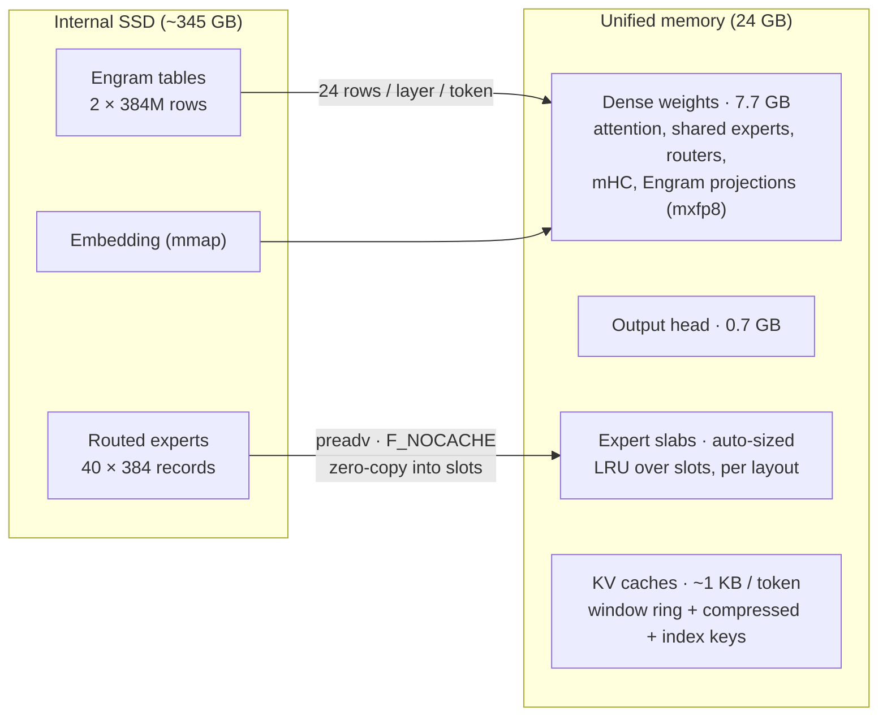
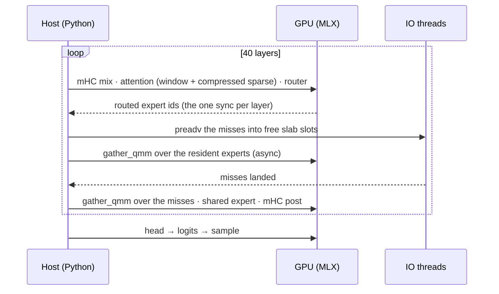

# Architecture

DeepSeek-V4.1-Flash has 754B parameters; a MacBook Air has 24 GB of memory. DeepInfer-Mac makes
that fit by keeping only what every token needs in memory and streaming the rest from the SSD.

## One decode step

## Where the model's structure helps

* **Cross-layer KV (the "encoder/decoder" split).** Layers 2, 8, 14 and 20 own compressors and
  index keys; every other layer reads the most recent owner's cache, and layer 20 serves layers
  21–39. The decoder half therefore sees the prompt only through layer 20's compressed KV plus its
  own 128-token window — which is what lets **SWA bounded replay** run the decoder on just the last
  140 prompt tokens.
* **Engram is a lookup, not a matmul.** Its 196B parameters are addressed by n-gram hashes of the
  tokens, so each position needs 48 rows of 160 bytes — a few random SSD reads.
* **6 of 384 experts per token** is what makes streaming viable: ~2 GB of expert reads per token,
  minus cache hits.

## Correctness strategy

1. Port `inference/model.py` op for op; keep every quantization point (fp8 activations before fp8
   GEMMs, fp4 index/compressed-KV caches, bf16 index scores).
2. Run the official PyTorch code as the oracle, with CPU emulations of its TileLang kernels, on
   small random configurations (`tests/test_parity.py`) and on the real converted layers
   (`scripts/real_check.py`).
3. Score the full model against continuations sampled from the official API
   (`scripts/score_api.py`).
